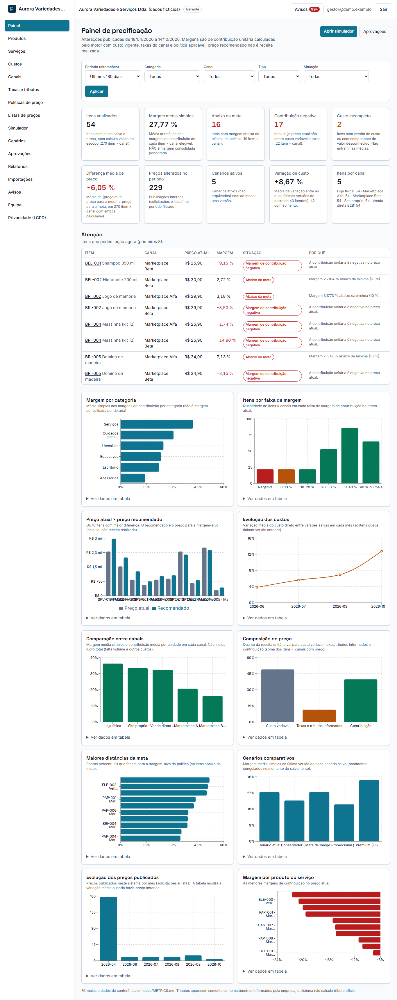

# Precificação Inteligente

Formação de preços e análise de rentabilidade **multiempresa**: composição de custos, taxas e comissões por canal, políticas de margem, simulador de preços e descontos, cenários comparáveis, listas de preços versionadas, aprovação de alterações, importação CSV, painel e relatórios. Next.js + TypeScript + Supabase (Postgres com RLS), com um **motor de cálculo decimal isolado e testado à mão** e as regras de versão, aprovação e publicação **dentro do banco**.

**Público:** indústrias, lojas e prestadores que definem preço de venda.
**Problema:** preço no feeling, sem considerar custos, taxas e margem.



## O que faz
- **Motor de precificação** (`lib/pricing/engine`): dinheiro em centavos, `decimal.js`, arredondamento só ao centavo; preço de equilíbrio e preço para a margem-alvo (inclusive com taxas sobre o preço líquido e com teto/piso); markup e margem **nunca confundidos**; desconto máximo; resultado gerencial após rateio; cenário inviável **nunca devolve preço**.
- **Custos**: componentes (lote, consumo por unidade, rateio de estrutura por volume, horas, percentual ou manual) viram **versões imutáveis**. Custo desconhecido **não é zero**: o item fica «incompleto».
- **Canais, taxas e tributos informados**: cada canal tem suas taxas (percentuais, fixas, com mínimo e teto). Tributos são parâmetros **informados** com origem registrada; o sistema não calcula tributo oficial.
- **Políticas de preço como dados**: margem-alvo, mínima, desconto máximo, arredondamento e preço mínimo, com precedência fixa (item+canal → item → categoria+canal → categoria → canal → global), vigência e conflito impedido no banco.
- **Simulador** em tempo real (e simulador de descontos), com o passo a passo «Como este preço foi calculado?»; o que é salvo ou proposto é **recalculado no servidor e no banco**.
- **Aprovação** de alterações de preço (propor → aprovar → publicar) com **segregação de funções**; **listas de preços** versionadas (rascunho → aprovação → publicação interna).
- **Cenários** com premissas congeladas (mudar uma taxa depois não altera um cenário salvo) e comparação lado a lado.
- **Importação CSV** com prévia validada no banco e confirmação atômica; preços importados **viram propostas**, nunca publicam; vendas observadas opcionais para margem **ponderada**.
- **Painel com 10 indicadores e 10 gráficos**, **17 relatórios** com CSV auditado, avisos internos, white-label e LGPD (Core).

## Não faz (fora do escopo)
Apuração tributária oficial, emissão fiscal, integração com marketplaces (publicar é interno), previsão de demanda ou elasticidade, XLSX/PDF, promessa de lucro.

## Começar em 1 minuto (com Claude Code ou Codex)

1. Abra o **Claude Code** (ou o Codex) numa pasta vazia do seu computador.
2. Copie o link deste repositório e cole no chat com o pedido abaixo:

```text
Instale o Precificação: https://github.com/pack-25-sistemas-ia/precificacao
Clone numa pasta nova e siga o guia .claude/commands/instalar.md. Explique cada passo e me pergunte quando precisar de algo meu.
```

3. Pronto: o agente clona, instala, sobe o banco local e abre o sistema. Depois da primeira vez, dentro da pasta, basta digitar `/instalar` no Claude Code para refazer ou consertar a instalação.

Prefere fazer à mão? Os passos manuais estão logo abaixo.


## Começar
```bash
pnpm install
supabase start && supabase db reset     # banco local com dados fictícios (seed reproduzível)
cp .env.example .env.local              # preencha com as chaves de «supabase status»
pnpm dev
```
Empresa fictícia «Aurora Variedades e Serviços Ltda.». Usuários locais (senha única `DemoLocal#2026`): `dono@demo.exemplo` (administrador), `gestor@demo.exemplo` (gestor comercial), `analista@demo.exemplo` e `analista2@demo.exemplo` (analistas), `consulta@demo.exemplo`. Detalhes em [docs/DEPLOYMENT.md](docs/DEPLOYMENT.md).

## Qualidade
```bash
pnpm lint && pnpm typecheck && pnpm test      # lint, tipos, testes unitários do motor e do CSV
pnpm build
pnpm test:db                                  # Postgres 17 em Docker: avaliação direta (F1–F10), custos, políticas, aprovação, listas, cenários, importação e acesso A×B
pnpm test:concurrency                         # sessões paralelas reais: publicação única, decisão única, numeração sem buracos, sem impasse
pnpm test:mutation                            # quebra regras críticas (banco e motor) de propósito; todas devem reprovar
pnpm test:e2e                                 # Playwright contra Supabase local e o app compilado
```
Os resultados reais de cada rodada estão em [MEMORY.md](MEMORY.md). O que não foi executado é dito como NÃO EXECUTADO.

## Documentação
[FEATURES](docs/FEATURES.md) · [Motor de precificação](docs/PRICING_ENGINE.md) · [Custos](docs/COST_MODEL.md) · [Margens](docs/MARGIN_RULES.md) · [Cenários](docs/SCENARIOS.md) · [Indicadores](docs/METRICS.md) · [Banco de dados](docs/DATABASE.md) · [Permissões](docs/PERMISSIONS.md) · [Arquitetura](docs/ARCHITECTURE.md) · [Decisões](docs/DECISIONS.md) · [Implantação](docs/DEPLOYMENT.md) · [Auditoria de código aberto](docs/OPEN_SOURCE_AUDIT.md)

## Privacidade (LGPD)
Risco estimado: **baixo**. Dados tratados: e-mail e nome da equipe; custos e margens são dados comerciais sensíveis (isolados por empresa por RLS). Quem implanta é o controlador dos dados; este software não substitui assessoria jurídica. Exportações auditadas, logs sem valores.

> Valor de implantação ilustrativo e sem promessa de resultado: veja `catalogo/sistemas.json` no hub do Pack.
